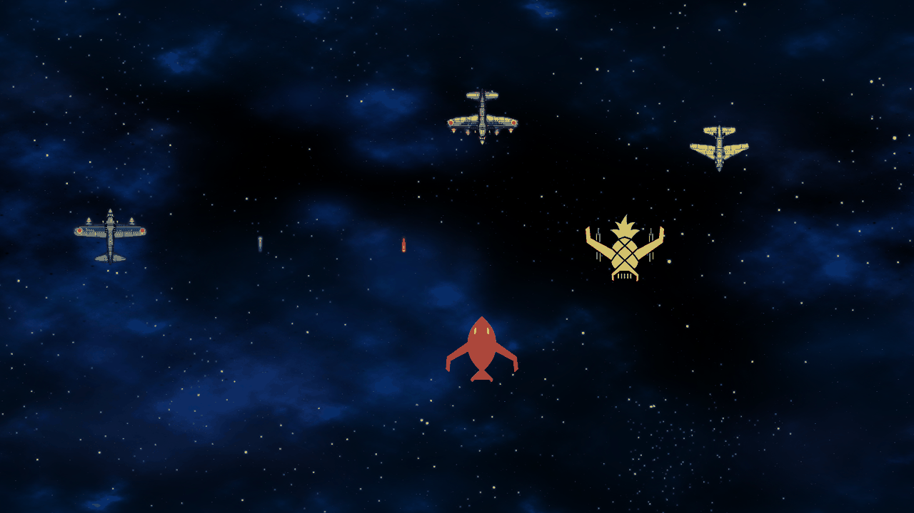

<h1 align="center">NexgenRedux-Media</h1>

<b>An example game for Nexgen Redux, written in AngelScript</b>

  

  
  

A shooter for the first [Nexgen Redux](https://github.com/Team-Resurgent/NexgenRedux) engine. It shows sprites, layered
scrolling backgrounds, text, collisions, music and sound, and input from a gamepad, keyboard or mouse.

  

Art from the game

## Layout

| Path | What it is |
|---|---|
| `Shooter/main.as` | The whole game |
| `Shooter/Asset/images` | Ships, bullets and backgrounds |
| `Shooter/Asset/fonts` | Bitmap fonts, and `freesans.sfn` |
| `Shooter/Asset/Audio`, `Shooter/Audio` | Music and sound |

## Running it

Copy the contents of `Shooter` into the media folder of a built Nexgen Redux, so that `main.as` is at its top, and start it.
The calls it uses are described in [NexgenRedux-Docs](https://team-resurgent.github.io/NexgenRedux-Docs/).

Some of the ships and backgrounds also appear in the new engine's showcase, in
[`engine/media/showcase`](https://github.com/Team-Resurgent/NexgenRedux/tree/main/engine/media/showcase).

## Related repositories

| Repository | What it is |
|---|---|
| [NexgenRedux](https://github.com/Team-Resurgent/NexgenRedux) | The engine |
| [NexgenRedux-Docs](https://github.com/Team-Resurgent/NexgenRedux-Docs) | The script reference |
