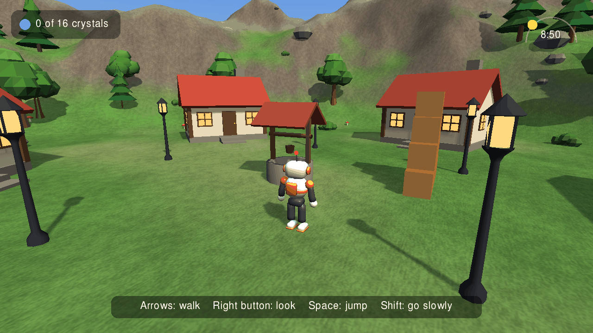
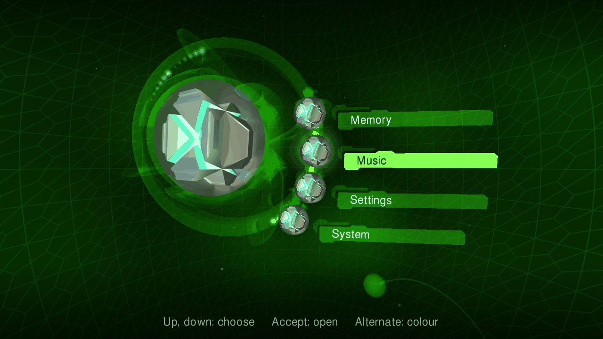
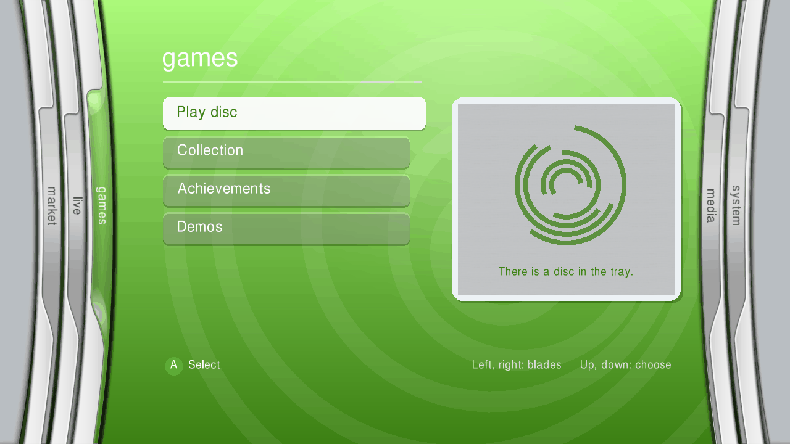
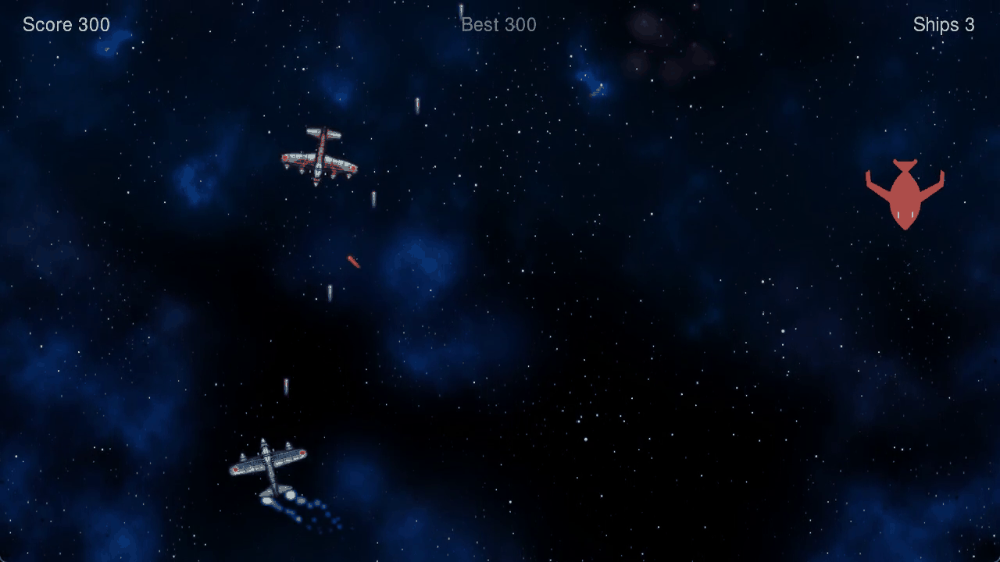
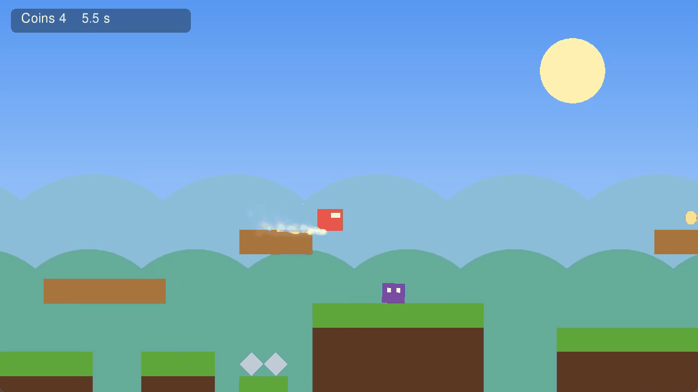
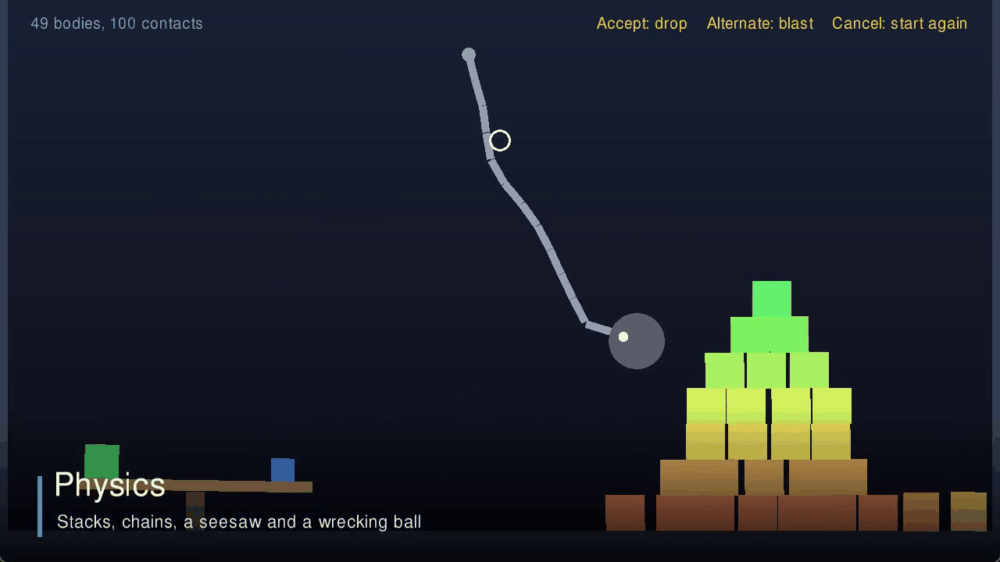
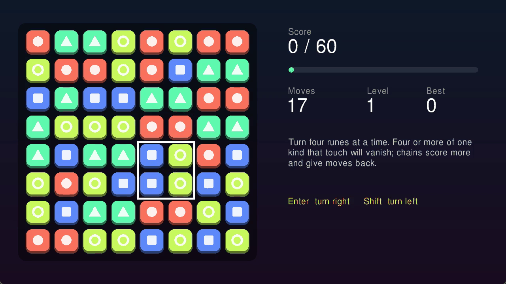
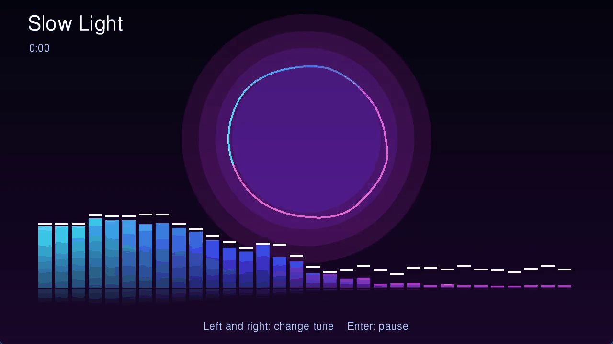
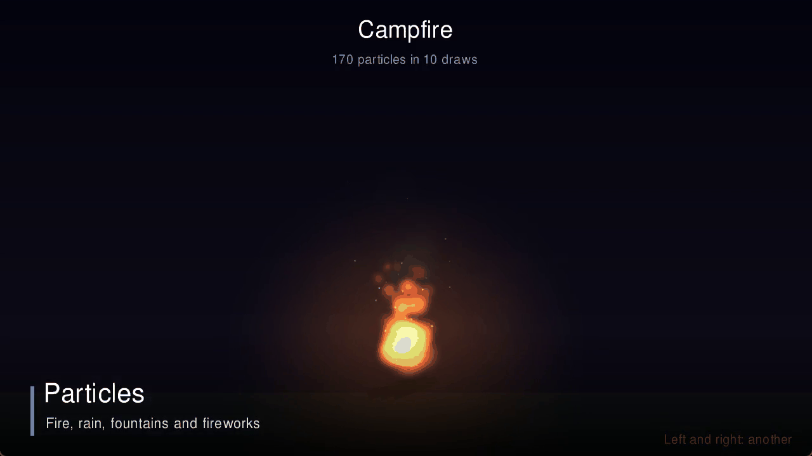

<h1 align="center">NexgenRedux-Media</h1>

<b>The demos of Nexgen Redux: one script each</b>

  
  

  
  

Everything that the [Nexgen Redux](https://github.com/Team-Resurgent/NexgenRedux) app shows, on every platform. To play them, get a
[release](https://github.com/Team-Resurgent/NexgenRedux/releases/latest); to read their scripts, see the
[demos page](https://team-resurgent.github.io/NexgenRedux-Docs/demos.html).

  
  
  

  
  
  

  
  
  

## Layout

| Path | What it is |
|---|---|
| `media/showcase/<name>/screen.json` | A demo's title, description and place in the menu, and what to press when it is shown off |
| `media/showcase/<name>/main.as` | Its script |
| `media/showcase/<name>/asset` | Its own pictures, sounds and scene files |
| `media/global` | Fonts, sounds and models that demos share |

Add a folder and it appears in the menu. How to write one is in the
[guide](https://team-resurgent.github.io/NexgenRedux-Docs/guide.html).

The sounds, music and test pictures are made by `engine/tools/make_media.py` in NexgenRedux, and the models by `make_models.py`.
The Dashboard's models and the Blades' pictures are from the first engine's skins.

## Related repositories

| Repository | What it is |
|---|---|
| [NexgenRedux](https://github.com/Team-Resurgent/NexgenRedux) | The engine |
| [NexgenRedux-Docs](https://github.com/Team-Resurgent/NexgenRedux-Docs) | The documentation site |
